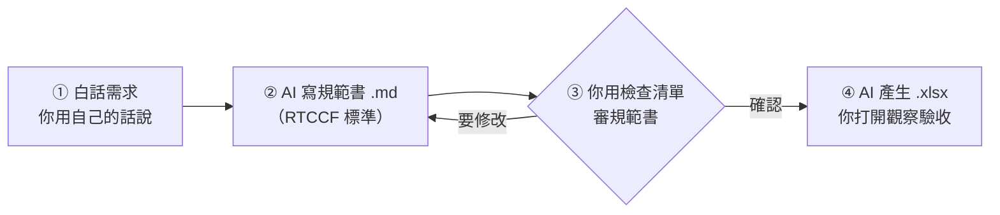

# 🟩 第一部｜用 AI 生成 Excel 試算表

| （第一部） | [🏠 課程總覽](../README.md) | [第二部：看懂資料與選對圖表 ➡️](../02_看懂資料與選對圖表/README.md) |
| :--- | :---: | ---: |

> [!IMPORTANT]
> **這一部你完全不用動手做表。** 表格全部由 AI 產生，你只要做三件事：
> 1. **懂名詞**：知道欄、列、公式、資料型態是什麼。
> 2. **審規範書**：AI 動手前會先交一份「試算表規範書」，你看懂、確認。
> 3. **觀察驗收**：打開 AI 做好的 `.xlsx`，對照規範書檢查。

🌐 **互動網站**：[第一部互動專區](https://roberthsu2003.github.io/ai-excel-analytics/excel-generation/)（名詞圖鑑、公式參照動畫、規範書流程動畫）

---

## 🧭 人機協作四步流程



| 步驟 | 你做什麼 | AI 做什麼 | 用到的檔案 |
| :-: | :--- | :--- | :--- | :-: |
| ① | 用白話描述需求 | — | [通用提示詞.md](./通用提示詞.md) |
| ② | — | 依 RTCCF 標準寫出規範書，**先不做 Excel** | [規範書範本.md](./00_RTCCF規範書標準/規範書範本.md)（⬇️ [下載](https://github.com/roberthsu2003/ai-excel-analytics/raw/main/01_%E7%94%A8AI%E7%94%9F%E6%88%90Excel/00_RTCCF%E8%A6%8F%E7%AF%84%E6%9B%B8%E6%A8%99%E6%BA%96/%E8%A6%8F%E7%AF%84%E6%9B%B8%E7%AF%84%E6%9C%AC.md)） |
| ③ | 逐項打勾，沒問題回覆「確認」 | 依你的意見修改 | [規範書檢查清單.md](./00_RTCCF規範書標準/規範書檢查清單.md) |
| ④ | 打開 `.xlsx`，對照規範書觀察 | 依規範書產生 `.xlsx` | 各課的觀察任務 |

> 💡 **不限定 AI**：任何能產生檔案的 AI 助理都可以。如果你的 AI 不能直接給檔案，就請它提供產生 `.xlsx` 的 Python 程式。

---

## 🗺️ 課程地圖：由淺至深

每一課**只多學一個 Excel 觀念**，並附上 AI 寫好的規範書和 xlsx 讓你打開觀察。

### 🧠 先備：看懂規範書的基礎

| 課 | 主題 | 你會帶走的能力 |
| :-: | :--- | :--- |
| 00 | 📘 [Excel 基本觀念](./00_Excel基本觀念/README.md) | 認得活頁簿、欄、列、儲存格、資料編輯列、資料型態、公式、錯誤代碼 |
| 00 | 📐 [RTCCF 規範書標準](./00_RTCCF規範書標準/README.md) | 知道規範書每一節在寫什麼、要看什麼 |

### 🟢 階段一：基礎建表

| 課 | 主題 | 情境 | 新觀念 | 下載 |
| :-: | :--- | :--- | :--- | :-: |
| 01 | [儲存格與資料型態](./01_儲存格與資料型態/README.md) | 社團收支紀錄 | 值 vs. 顯示格式；文字、數值、日期 | ⬇️ [xlsx](https://github.com/roberthsu2003/ai-excel-analytics/raw/main/01_%E7%94%A8AI%E7%94%9F%E6%88%90Excel/01_%E5%84%B2%E5%AD%98%E6%A0%BC%E8%88%87%E8%B3%87%E6%96%99%E5%9E%8B%E6%85%8B/%E7%A4%BE%E5%9C%98%E6%94%B6%E6%94%AF%E7%B4%80%E9%8C%84.xlsx) |
| 02 | [公式與參照](./02_公式與參照/README.md) | 商品報價單 | 公式；相對參照 vs. `$` 絕對參照 | ⬇️ [xlsx](https://github.com/roberthsu2003/ai-excel-analytics/raw/main/01_%E7%94%A8AI%E7%94%9F%E6%88%90Excel/02_%E5%85%AC%E5%BC%8F%E8%88%87%E5%8F%83%E7%85%A7/%E5%95%86%E5%93%81%E5%A0%B1%E5%83%B9%E5%96%AE.xlsx) |
| 03 | [常用函數](./03_常用函數/README.md) | 班級成績表 | SUM、AVERAGE、ROUND、MAX、MIN、COUNT；空白 ≠ 0 | ⬇️ [xlsx](https://github.com/roberthsu2003/ai-excel-analytics/raw/main/01_%E7%94%A8AI%E7%94%9F%E6%88%90Excel/03_%E5%B8%B8%E7%94%A8%E5%87%BD%E6%95%B8/%E7%8F%AD%E7%B4%9A%E6%88%90%E7%B8%BE%E8%A1%A8.xlsx) |
| 04 | [一列一筆與結構化表格](./04_一列一筆與結構化表格/README.md) | 部門費用報銷表 | 四不二要；固定範圍 vs. 結構化表格，新增資料不用重寫公式 | ⬇️ [xlsx](https://github.com/roberthsu2003/ai-excel-analytics/raw/main/01_%E7%94%A8AI%E7%94%9F%E6%88%90Excel/04_%E4%B8%80%E5%88%97%E4%B8%80%E7%AD%86%E8%88%87%E7%B5%90%E6%A7%8B%E5%8C%96%E8%A1%A8%E6%A0%BC/%E9%83%A8%E9%96%80%E8%B2%BB%E7%94%A8%E5%A0%B1%E9%8A%B7%E8%A1%A8.xlsx) |

### 🟡 階段二：判斷、防呆與警示

| 課 | 主題 | 情境 | 新觀念 | 下載 |
| :-: | :--- | :--- | :--- | :-: |
| 05 | [邏輯判斷](./05_邏輯判斷/README.md) | 業績獎金判定 | IF、IFS、AND | ⬇️ [xlsx](https://github.com/roberthsu2003/ai-excel-analytics/raw/main/01_%E7%94%A8AI%E7%94%9F%E6%88%90Excel/05_%E9%82%8F%E8%BC%AF%E5%88%A4%E6%96%B7/%E6%A5%AD%E7%B8%BE%E7%8D%8E%E9%87%91%E5%88%A4%E5%AE%9A.xlsx) |
| 06 | [資料驗證](./06_資料驗證/README.md) | 請假申請表 | 下拉選單、數值範圍、日期限制 | ⬇️ [xlsx](https://github.com/roberthsu2003/ai-excel-analytics/raw/main/01_%E7%94%A8AI%E7%94%9F%E6%88%90Excel/06_%E8%B3%87%E6%96%99%E9%A9%97%E8%AD%89/%E8%AB%8B%E5%81%87%E7%94%B3%E8%AB%8B%E8%A1%A8.xlsx) |
| 07 | [條件式格式](./07_條件式格式/README.md) | 專案進度管控 | 超支紅字、逾期黃底、資料橫條 | ⬇️ [xlsx](https://github.com/roberthsu2003/ai-excel-analytics/raw/main/01_%E7%94%A8AI%E7%94%9F%E6%88%90Excel/07_%E6%A2%9D%E4%BB%B6%E5%BC%8F%E6%A0%BC%E5%BC%8F/%E5%B0%88%E6%A1%88%E9%80%B2%E5%BA%A6%E7%AE%A1%E6%8E%A7%E8%A1%A8.xlsx) |

### 🔵 階段三：跨表與整理

| 課 | 主題 | 情境 | 新觀念 | 下載 |
| :-: | :--- | :--- | :--- | :-: |
| 08 | [主檔與跨表查詢](./08_主檔與跨表查詢/README.md) | 訂單＋產品主檔 | XLOOKUP、查無資料的處理、三層分工 | ⬇️ [xlsx](https://github.com/roberthsu2003/ai-excel-analytics/raw/main/01_%E7%94%A8AI%E7%94%9F%E6%88%90Excel/08_%E4%B8%BB%E6%AA%94%E8%88%87%E8%B7%A8%E8%A1%A8%E6%9F%A5%E8%A9%A2/%E8%A8%82%E5%96%AE%E8%88%87%E7%94%A2%E5%93%81%E4%B8%BB%E6%AA%94.xlsx) |
| 09 | [條件統計彙總](./09_條件統計彙總/README.md) | 多通路銷售 | SUMIFS、COUNTIFS；樞紐分析的觀念 | ⬇️ [xlsx](https://github.com/roberthsu2003/ai-excel-analytics/raw/main/01_%E7%94%A8AI%E7%94%9F%E6%88%90Excel/09_%E6%A2%9D%E4%BB%B6%E7%B5%B1%E8%A8%88%E5%BD%99%E7%B8%BD/%E5%A4%9A%E9%80%9A%E8%B7%AF%E9%8A%B7%E5%94%AE%E5%BD%99%E7%B8%BD.xlsx) |
| 10 | [髒資料清洗](./10_髒資料清洗/README.md) | 採購需求原始文字 | 民國年轉日期、剝除單位、原始與清洗後對照 | ⬇️ [xlsx](https://github.com/roberthsu2003/ai-excel-analytics/raw/main/01_%E7%94%A8AI%E7%94%9F%E6%88%90Excel/10_%E9%AB%92%E8%B3%87%E6%96%99%E6%B8%85%E6%B4%97/%E6%8E%A1%E8%B3%BC%E9%9C%80%E6%B1%82%E6%B8%85%E6%B4%97.xlsx) |

### 🟣 階段四：視覺化

| 課 | 主題 | 情境 | 新觀念 | 下載 |
| :-: | :--- | :--- | :--- | :-: |
| 11 | [圖表](./11_圖表/README.md) | 月營收 | 長條圖、折線圖、圓餅圖 | ⬇️ [xlsx](https://github.com/roberthsu2003/ai-excel-analytics/raw/main/01_%E7%94%A8AI%E7%94%9F%E6%88%90Excel/11_%E5%9C%96%E8%A1%A8/%E6%9C%88%E7%87%9F%E6%94%B6%E5%9C%96%E8%A1%A8.xlsx) |
| 12 | [主管儀表板總整](./12_主管儀表板總整/README.md) | 全通路營運 | KPI 卡片＋圖表；資料層與展示層分頁 | ⬇️ [xlsx](https://github.com/roberthsu2003/ai-excel-analytics/raw/main/01_%E7%94%A8AI%E7%94%9F%E6%88%90Excel/12_%E4%B8%BB%E7%AE%A1%E5%84%80%E8%A1%A8%E6%9D%BF%E7%B8%BD%E6%95%B4/%E5%85%A8%E9%80%9A%E8%B7%AF%E7%87%9F%E9%81%8B%E5%84%80%E8%A1%A8%E6%9D%BF.xlsx) |

---

## 📂 每一課的檔案

```
01_儲存格與資料型態/
├── README.md                ← 本課觀念、白話需求、觀察任務
├── 規範書_社團收支紀錄.md     ← AI 依 RTCCF 標準寫的規範書
└── 社團收支紀錄.xlsx          ← AI 依規範書產生的檔案（打開觀察用）
```

## 🔑 貫穿全部的五條鐵律

1. **資料列不合併儲存格**：一列就是一筆，才能排序、篩選、樞紐分析。
2. **型態要對**：金額是數值（不打「元」），日期是日期（不存成文字），編號要保留 0 就存成文字。
3. **公式優先**：算出來的都用公式，不填死值。
4. **資料和報表分開**：明細放資料層，總計、圖表放展示層。
5. **會新增資料的表用結構化表格**：每列公式用 `[@欄位]`，彙總用 `表格[欄位]`，新增一筆不用重寫公式（第 04 課起）。

> 前四條也是[第二部](../02_看懂資料與選對圖表/README.md)、[第三部](../03_AI協作資料分析/README.md)讓 AI 讀懂你資料的前提。

---

[⬅️ 回到課程總覽](../README.md)
