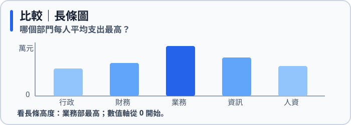
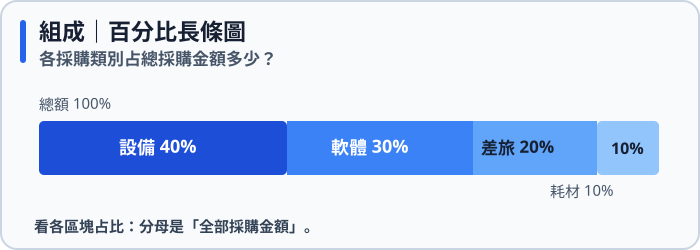
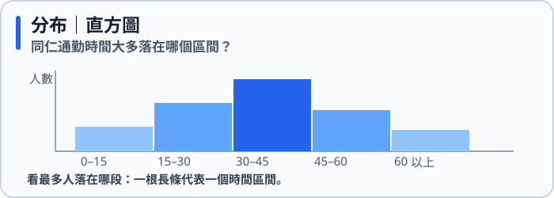
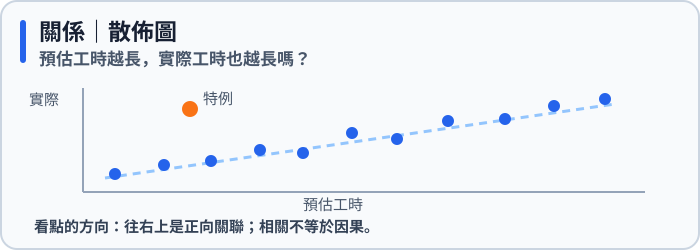
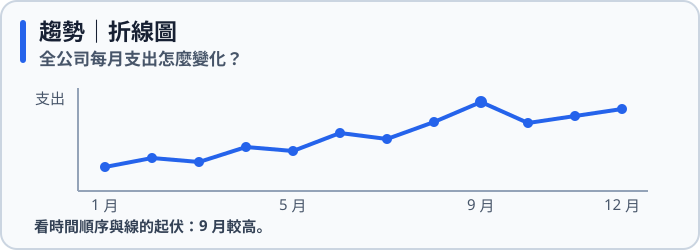

# 🎯 五大問題類別與識別句型：你問的是哪一種問題？

> 📚 **本文是「看懂資料與選對圖表」的第 4 課**。前三課你學會了貼標籤、套積木問出問題、檢查邊界；這一課要把問題**分類**——因為**圖表是由問題的類別決定的，不是由資料長相決定的**。

> 🌐 想看五種問題如何「長出」對應的 15 大常用圖表？ [五大問題與圖表動態展示（網頁版）](https://roberthsu2003.github.io/ai-excel-analytics/chart-selection/question-types.html)

---

## 一、五大問題類別一覽

| 類別 | 在問什麼 | 聽到這種關鍵字 | 通常用到的欄位 | 首選與常用圖表（共 15 種） |
| :--- | :--- | :--- | :--- | :--- |
| **比較** (Comparison) | 誰高誰低、排第幾、差距多少 | 最高、最低、排名、差多少、比對 | 1 類別 ＋ 1 指標（或 2 指標） | **垂直長條圖**、**水平長條圖**、**分組長條圖**、**點圖/棒棒糖圖** |
| **組成** (Composition) | 整體裡各部分占多少、份額比例 | 占比、比例、百分之幾、主要來自、總量加成分 | 1 類別 ＋ 1 指標（加總） | **100% 百分比長條圖**、**甜甜圈圖/圓餅圖**、**堆疊長條圖** |
| **分布** (Distribution) | 數字大多落在哪、離散度與極端值 | 大多、集中、分散、範圍、異常、偏態 | 1 指標（很多筆連續資料） | **直方圖**、**箱形圖 / 盒鬚圖** |
| **關係** (Relationship) | 兩個或多個變數會不會一起變 | 越…越…、正負相關、連動、有無關聯 | 2 個或 3 個以上連續指標 | **散佈圖**、**氣泡圖**、**相關係數熱力圖** |
| **趨勢** (Trend) | 隨時間先後怎麼改變、週期與走勢 | 成長、衰退、走勢、週期、轉折、累積變化 | 1 時間 ＋ 1 指標（或多類別累積） | **折線圖**、**時間長條圖**、**堆疊面積圖** |

---

## 二、用同一份資料，問出五種核心問題

同一份**辦公室資料**，問不同的問題，就要用不同的圖（資料在[學生素材](../學生素材/DATA_CARD.md)）：

| 問題 | 關鍵字 | 類別 | 首選圖表 |
| :--- | :--- | :--- | :--- |
| 哪個部門每人平均支出**最高**？ | 最高 | 比較 | 垂直長條圖 |
| 各採購類別**各占**全年採購金額多少？ | 各占 | 組成 | 百分比長條圖 |
| 同仁通勤時間**大多**落在幾分鐘？ | 大多 | 分布 | 直方圖 |
| 預估工時**越長**，實際工時**也越長**嗎？ | 越…越… | 關係 | 散佈圖 |
| 全公司每月支出**怎麼變化**？ | 變化 | 趨勢 | 折線圖 |

> 💡 **判斷口訣**：先圈出問句裡的**關鍵字**，再看它用到哪幾種欄位。關鍵字和欄位組合都對上了，類別就確定了。

### 看圖對照：五種問題會長成什麼圖？

下面的數字都是**示意資料**，目的是先認出圖形。每張圖上方是問題，下方提示你該看圖的哪個部分。

---

## 三、五大問題延伸：15 大常用圖表識別句型與適用時機

同一個問題類別，會因手邊資料的**項目數量、標籤長度、指標個數、時間長短**而延伸出不同的最佳圖表。以下彙整 15 大常用圖表的精準識別句型與挑選時機：

### 1. 比較類 (Comparison) 識別句型
*聚焦於「高低排名」與「數值差距」*

| 圖表名稱 | 英文名稱 | 典型識別句型（使用者會這樣問） | 適用資料特徵與核心時機 |
| :--- | :--- | :--- | :--- |
| **垂直長條圖** | Column Chart | 「北、中、南三區的業績誰排第一？」 「哪一個產品類別上月銷量最高？」 | 項目少（$\le 6$ 個）且名稱簡短；**Y 軸必須從 0 起跳**。 |
| **水平長條圖** | Horizontal Bar Chart | 「全公司 15 個部門的年度花費排名由高到低為何？」 「『客戶關係管理暨售後服務部』等長項目誰表現好？」 | 項目較多（$\ge 7$ 個）或標籤文字較長；**建議數值由大到小排序**。 |
| **分組長條圖** | Grouped Bar Chart | 「各部門的『今年預算』與『實際花費』差距多少？」 「各門市今年與去年同期的營業額對比誰有達標？」 | 跨 2 個連續指標（如預算 vs 實際、今年 vs 去年）並列對比。 |
| **點圖 / 棒棒糖圖** | Dot / Lollipop Plot | 「全台 30 家分店的坪效各是多少？想精確對比數值但不要大色塊壓迫。」 | 項目極多（15～30 個）時，以細線端點精準標記數值，畫面乾淨清爽。 |

---

### 2. 組成類 (Composition) 識別句型
*聚焦於「部分占整體份額」，各部分相加必須為 100%（或等於總量）*

| 圖表名稱 | 英文名稱 | 典型識別句型（使用者會這樣問） | 適用資料特徵與核心時機 |
| :--- | :--- | :--- | :--- |
| **100% 百分比長條圖** | 100% Stacked Bar | 「各採購類別各占全公司總支出百分之幾？」 「各部門的人事費、差旅費、耗材費佔比結構有何不同？」 | **商業分析首選！** 人眼對長度比對最敏感，單組或跨組結構比較皆清晰。 |
| **甜甜圈圖 / 圓餅圖** | Donut / Pie Chart | 「線上信用卡刷卡金額是否已經佔據全店總額的大半？」 「男女會員比例大約是幾比幾？」 | **僅限類別極少（$\le 4$ 個）**且想強調某單一主導份額時；切忌細切成披薩碎塊。 |
| **堆疊長條圖** | Stacked Bar Chart | 「各季度的總銷售額是多少？其中門市與官網各自貢獻了多少金額？」 | 想同時掌握**各類別總額高低**與**內部各成分金額貢獻**時；注意浮動基準線。 |

---

### 3. 分布類 (Distribution) 識別句型
*探查大量單一數值的集中趨勢、離散程度與極端異常值*

| 圖表名稱 | 英文名稱 | 典型識別句型（使用者會這樣問） | 適用資料特徵與核心時機 |
| :--- | :--- | :--- | :--- |
| **直方圖** | Histogram | 「全體員工的通勤時間大多落在幾分鐘？分佈對稱嗎？」 「客戶單筆消費金額主要集中在幾百元區間？」 | 單一連續數值（大量列），切分成等寬區間 (Bins) 看波峰頻率；柱與柱相連。 |
| **箱形圖 / 盒鬚圖** | Box Plot | 「各部門薪資中位數是多少？是否有百萬月薪的極端高薪個案？」 「各專案工時有沒有特別嚴重的離群延遲事件？」 | 檢驗 5 數統計概括、排查離群異常值 (Outliers)；中位數與四分位距 (IQR) 不受極端值拉偏。 |

---

### 4. 關係類 (Relationship) 識別句型
*探討兩個或多個連續變數之間是否共同連動*

| 圖表名稱 | 英文名稱 | 典型識別句型（使用者會這樣問） | 適用資料特徵與核心時機 |
| :--- | :--- | :--- | :--- |
| **散佈圖** | Scatter Plot | 「業務同仁的拜訪次數越頻繁，成交金額就越高嗎？」 「廣告投放金額與新用戶註冊數之間是否有正向關聯？」 | 2 個連續數值指標，觀察點群集聚走向（正相關、負相關、無關）；**點絕對不可連線**。 |
| **氣泡圖** | Bubble Chart | 「在看廣告費與營收關聯時，能否同時呈現各商品的總利潤規模？」 | 3 個連續數值指標；X 軸與 Y 軸為前兩變數，圓形面積代表第 3 個變數規模。 |
| **相關係數熱力圖** | Correlation Heatmap | 「薪資、年資、工時、績效與缺勤率這 5 個變數，哪兩個連動最強？」 「資料表中數十個數值欄位，彼此之間的相關矩陣長怎樣？」 | 3 個以上連續數值指標時，以色彩矩陣全景掃描兩兩變數間的相關係數數值 (-1 到 +1)。 |

---

### 5. 趨勢類 (Trend) 識別句型
*觀察數值隨時間先後序列演進的變化走勢、週期與累積量*

| 圖表名稱 | 英文名稱 | 典型識別句型（使用者會這樣問） | 適用資料特徵與核心時機 |
| :--- | :--- | :--- | :--- |
| **折線圖** | Line Chart | 「過去 12 個月全公司營業額走勢是在成長還是下滑？」 「官網每日活躍用戶在週末是否有週期性波動？」 | 時間序列較長（$> 5$ 個時間點），透過斜率展示走勢變化；**非時間類別嚴禁連線**。 |
| **時間長條圖** | Time-series Bar | 「公司近 3 年的年度營收成長如何？」 「今年 4 個季度的業績表現各是多少？」 | 時間點極少時（僅 3～4 個季度或年份），長條圖比短短的折線更具穩重量體感。 |
| **堆疊面積圖** | Stacked Area Chart | 「過去一年全體總營收的月度變化中，實體門市與電商通路的累積貢獻怎麼消長？」 | 多個類別隨時間演進的累積量變化；類別建議控制在 3 個以內以防視線混亂。 |

---

## 四、容易混淆的關鍵辨析

### 1. 比較 vs. 組成
- 「哪個部門花**最多**錢？」➔ **比較**（看高低差距，用數值本身，長條圖首選）
- 「哪個部門的花費**占全公司幾成**？」➔ **組成**（看份額比例，要先算分母＝全公司總額，百分比長條圖首選）

### 2. 比較 vs. 趨勢
- 「財務、業務、資訊三個部門誰支出高？」➔ **比較**（部門無先後順序，不可連線）
- 「1 月到 12 月支出怎麼變？」➔ **趨勢**（月份有嚴格時間順序，連成折線才有意義）

### 3. 分布 vs. 比較
- 「同仁通勤時間**大多**幾分鐘？」➔ **分布**（看群體內所有原始數字散落在哪個區間，直方圖或箱形圖）
- 「哪個部門的**平均**通勤時間最長？」➔ **比較**（每組先壓縮成一個代表數值，再比高低，長條圖）

### 4. 直方圖 vs. 長條圖
- **直方圖 (Histogram)**：X 軸是「連續數值切分的等寬區間 (Bins)」，柱與柱之間**緊密相連無縫隙**。
- **長條圖 (Bar Chart)**：X 軸或 Y 軸是「彼此獨立的文字類別」，柱與柱之間**必須保留間隙**。

### 5. 100% 百分比長條圖 vs. 堆疊長條圖
- **100% 百分比長條圖**：所有柱子長度基準線全部拉齊為 100%，純粹比對「相對結構百分比」。
- **堆疊長條圖**：每根柱子的總高度不同，代表「實際總量大小」，同時能看內部各子項目的數值貢獻。

---

## 五、小練習：這是哪一類？該選哪種圖？

先自己想，再展開答案。

1. 「上半年哪一個月的訂單最多？每個月的變化走勢如何？」
2. 「客訴原因中，『出貨延遲』占了全體客訴多少比例？」
3. 「廣告費越高的月份，營收是不是也越高？利潤規模大嗎？」
4. 「客服回覆時間大多在幾分鐘內？有沒有超出 3 天的極端延誤個案？」
5. 「全台 20 家門市的業績排名由高到低為何？店名很長。」
6. 「公司 5 個財務指標之間，哪些兩兩指標高度相關？」

👉 點此看答案

1. **趨勢類** ➔ 時間序列長用**折線圖**；若只看少數 3~4 個季度可用**時間長條圖**。
2. **組成類** ➔ 項目多時首選 **100% 百分比長條圖**；若只有少數 2~3 個分類且占比懸殊可用**甜甜圈圖**。
3. **關係類** ➔ 兩個數值用**散佈圖**；若還想加入第 3 個利潤指標規模，則使用**氣泡圖**。
4. **分布類** ➔ 看整體大多集中在哪用**直方圖**；若要明確抓出極端離群值與中位數，首選**箱形圖 (Box Plot)**。
5. **比較類** ➔ 項目多且文字長，首選**水平長條圖 (Horizontal Bar Chart)**，並由大到小排序。
6. **關係類** ➔ 3 個以上連續數值變數的全景掃描，首選**相關係數熱力圖 (Correlation Heatmap)**。

---

## ✅ 這一課帶走的重點

> **問題的類別決定圖表大方向，資料特徵決定具體圖表。**  
> 先圈出問句關鍵字判斷五大類（比較、組成、分布、關係、趨勢），再依據手邊的項目數量、文字長度、指標變數與時間特徵，精準挑選出最適當的那張圖。

---

### 🧭 課程導覽

| ⬅️ 上一課 | 🏠 | 下一課 ➡️ |
| :--- | :---: | ---: |
| [第 1～3 課：欄位、積木與邊界](../數據欄位與提問思考規則/README.md) | [學習地圖](../README.md) | [第 5 課：認識圖表與坐標軸](../常用圖表名稱與坐標軸說明/README.md) |

