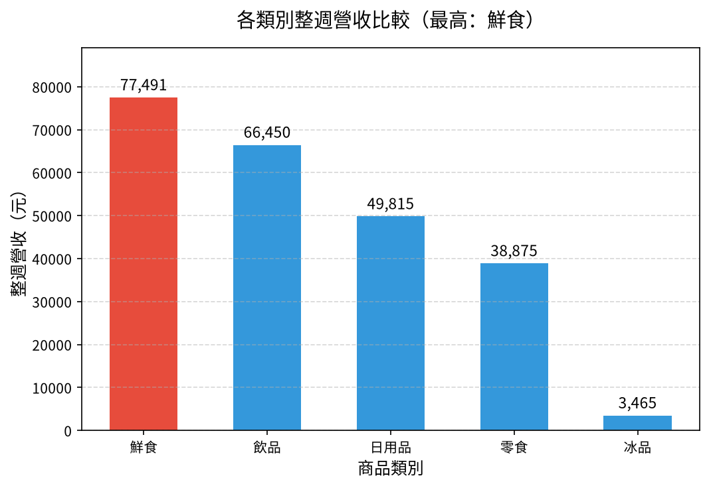

# 📊 02｜便利商店一週銷售：三階提問實作

[](https://colab.research.google.com/github/roberthsu2003/ai-excel-analytics/blob/main/AI%E5%8D%94%E4%BD%9C%E8%B3%87%E6%96%99%E5%88%86%E6%9E%90/02_store_sales/lesson.ipynb) 👉 **[開啟本例筆記本 lesson.ipynb](./lesson.ipynb)**

| [⬅️ 01 班級段考成績](../01_class_scores/README.md) | [🏠 範例庫目錄](../README.md) | [03 圖書館借閱 ➡️](../03_library_files/README.md) |
| :--- | :---: | ---: |

## 📌 本例速覽

| 項目 | 內容 |
| :--- | :--- |
| 資料情境 | `sales.csv（一週 7 天各商品銷售量與單價）` |
| 一列代表 | **某一天、某一個品項的銷售紀錄** |
| 官方範例問題 | **哪一類商品整週總營收最高？** |
| 官方推薦圖表 | **垂直長條圖** |
| 學習模式 | **三階提問法**：① 看懂資料 ➔ ② 一題一圖（人機選圖） ➔ ③ 解讀洞察與限制 ➔ ④ RTCCF 交付 |

### 🎯 官方範例主線成果圖


> [!TIP]
> **你不需要會寫程式。** 在本範例中，你負責想問題、從 AI 建議中評估選圖、親自檢查邊界與核對數字；寫程式與繪圖完全交給 Colab 裡的 AI。

---

## 1️⃣ 資料背景與思考邊界

### ① 欄位角色貼標籤
| 欄位名稱 | 資料類型 | 欄位角色 (Data Role) | 說明與規則 |
| :--- | :--- | :--- | :--- |
| **日期** | 文字日期（7 天） | 🔵 **條件 (Dimension)／時間** | 2025-03-03～03-09，一週；只有 7 天，不足以談長期趨勢。 |
| **品項** | 文字 | 🔵 **條件 (Dimension)／類別** | 25 種商品名稱，用來分組或篩選，不參與數值運算。 |
| **類別** | 文字（5 類） | 🔵 **條件 (Dimension)／類別** | 鮮食、飲品、零食、日用品、冰品；本例主要的分組依據。 |
| **單價** | 整數（元） | 🟢 **指標 (Metric)** | 每件售價。**單價直接加總沒有意義**，要和數量相乘才是營收。 |
| **數量** | 整數（件） | 🟢 **指標 (Metric)** | 當日售出件數。件數多不等於賺得多。 |
| **營收（需自行計算）** | 整數（元） | 🟢 **衍生指標** | 原檔沒有此欄，必須逐列計算「單價 × 數量」。 |

### ② 邊界檢核防呆（分析紅線）
- ⚠️ **缺指標先衍生**：原檔沒有「營收」欄；只看數量會回答成「哪類賣最多件」，不是「哪類賺最多」。
- ⚠️ **單價不能加總**：把所有單價加起來不代表任何意義；營收要逐列「單價 × 數量」再加總。
- ⚠️ **期間太短**：只有一週 7 天，不能推論長期銷售趨勢或季節性。
- ⚠️ **缺欄位不推原因**：資料中**沒有天氣欄位**，看到某天雨傘大賣，也不能只靠這張表斷定是下雨造成。

---

## 2️⃣ 在 Colab 操作：三階提問 SOP

點擊上方 **Open in Colab** 徽章開啟 [`lesson.ipynb`](./lesson.ipynb) 後，依序進行人機協作：

### 第 0 步｜載入資料與繁中字型
點擊第 0 步儲存格左側的 ▶ 執行按鈕，系統會自動下載所需資料並配置繁體中文字型。

### ① 第一階｜看懂資料
將以下 Prompt 貼給 Colab 側邊的 Gemini AI：
```text
請讀取已載入/下載的資料（data/sales.csv）：
1. 顯示前 5 列、總列數、所有欄位名稱與各欄缺值數
2. 說明「一列代表什麼」，並將所有欄位分成「指標」、「條件」、「標識」三種角色
3. 檢查資料的時間範圍、重複值或異常/缺值狀況
4. 根據資料欄位，提出 5 個可以回答的商業/分析問題（涵蓋不同面向），以及 1 個不能回答的問題並說明理由
⚠️ 先不要寫程式畫圖，也不要提前下推論或結論。
```
**驗收標準**：確認資料筆數、缺值數量與欄位角色判斷是否正確。

---

### ② 第二階｜一個問題、一張圖（人機協作選圖）

#### 步驟 2-1｜填入問題，請 AI 建議圖表與優缺點
你可以從第一階產生的 5 個問題中挑選，或使用官方範例問題：
```text
延續第一階，我想針對這個問題進行深入分析：
『哪一類商品整週總營收最高？』

請先不要寫程式畫圖，請先：
1. 說明這個問題屬於哪種問題類型（比較、趨勢、占比、分布、關聯）。
2. 建議 2～3 種適合呈現此問題的圖表類型，並條列分析每種圖表的「優點」與「缺點」（請考慮類別數量、名稱長短、數值特性等）。
3. 說明你最推薦哪一種圖表，以及推薦的理由是什麼。
等我確認要採用哪種圖表後，我們再進行下一步。
```

#### 步驟 2-2｜決定圖表，請 AI 產出數字表與繪圖
由你根據選圖規則決定圖表類型（例如：垂直長條圖）：
```text
我決定採用【垂直長條圖】。

請先產出排序好的統計數字表，再只畫一張【垂直長條圖】。
繪圖注意事項：
1. 自動配置合適的坐標軸（若有數值軸請從 0 開始，避免截斷視覺比例）
2. 圖上清楚標註數值與單位，文字全部使用繁體中文（沿用已設定的字型）
3. 排除無效或缺值的資料，並符合邊界檢核防呆
⚠️ 一次只回答這個問題，不要畫其他無關圖表。
```
> 💡 **官方範例推薦理由：** 比較 4 大商品類別整週營收總和，垂直長條圖高低落差一目了然；Y 軸從 0 開始並清楚標示金額單位（元）。

**驗收標準**：核對圖表上的數字與排序數字表一致，數值軸從 0 開始，單位標註清楚。

---

### ③ 第三階｜解讀數據與圖表（說出洞察與限制）
留在同一段 AI 對話，請 AI 完整解讀：
```text
請根據剛才產出的數字表與圖表，說明如何正確解釋這些分析結果。

解讀注意事項：
1. 核心結論：回答剛才設定的問題，並引用圖表中的具體數據支持
2. 數據洞察：說明數據與圖表呈現的重要現象、極端值或趨勢特徵
3. 資料限制：寫明統計範圍、分母，以及是否有被排除的資料（如缺考、異常值、未完成訂單）
4. 不能推論的事：說明單憑目前數據無法證明什麼（嚴守邊界：不把相關當因果、不妄下過度結論）
```
**驗收標準**：結論有具體數據支持，未把相關當因果，並指明資料限制。

---

### ④ 第四階｜交付報告（選做：產出 RTCCF 提示詞）
完成分析後，可使用第四階 Prompt，請 Colab AI 將前三階成果打包成符合 **RTCCF 框架** 的提示詞，直接交給外部 AI 生成可交付的 **Word 報告（.docx）** 或 **Excel 活頁簿（.xlsx）**！

---

| [⬅️ 01 班級段考成績](../01_class_scores/README.md) | [🏠 範例庫目錄](../README.md) | [03 圖書館借閱 ➡️](../03_library_files/README.md) |
