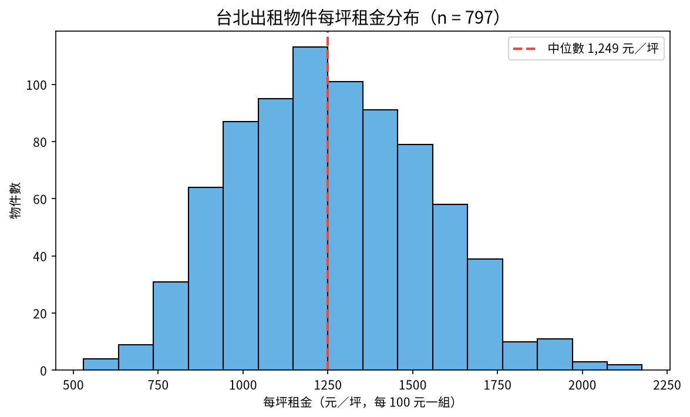

# 📊 10｜台北租屋：三階提問實作

[](https://colab.research.google.com/github/roberthsu2003/ai-excel-analytics/blob/main/AI%E5%8D%94%E4%BD%9C%E8%B3%87%E6%96%99%E5%88%86%E6%9E%90/10_rent_seaborn/lesson.ipynb) 👉 **[開啟本例筆記本 lesson.ipynb](./lesson.ipynb)**

| [⬅️ 09 六城市氣象](../09_weather_charts/README.md) | [🏠 範例庫目錄](../README.md) | [11 業務週報 ➡️](../11_sales_kpi_style/README.md) |
| :--- | :---: | ---: |

## 📌 本例速覽

| 項目 | 內容 |
| :--- | :--- |
| 資料情境 | `rent_taipei.csv（台北市租屋刊登資料：租金、坪數、行政區、型態）` |
| 一列代表 | **一筆出租房屋物件** |
| 官方範例問題 | **排除異常值後，台北市每坪租金大多落在多少區間？** |
| 官方推薦圖表 | **直方圖** |
| 學習模式 | **三階提問法**：① 看懂資料 ➔ ② 一題一圖（人機選圖） ➔ ③ 解讀洞察與限制 ➔ ④ RTCCF 交付 |

### 🎯 官方範例主線成果圖


> [!TIP]
> **你不需要會寫程式。** 在本範例中，你負責想問題、從 AI 建議中評估選圖、親自檢查邊界與核對數字；寫程式與繪圖完全交給 Colab 裡的 AI。

---

## 1️⃣ 資料背景與思考邊界

### ① 欄位角色貼標籤
| 欄位名稱 | 資料類型 | 欄位角色 (Data Role) | 說明與規則 |
| :--- | :--- | :--- | :--- |
| **物件編號** | 文字代碼 | ⚪ **標識 (Identifier)** | R0001～R0800，只能計數或辨識。 |
| **行政區** | 文字（6 區） | 🔵 **條件 (Dimension)／類別** | 大安、信義、中山、松山、文山、北投。 |
| **類型** | 文字（3 類） | 🔵 **條件 (Dimension)／類別** | 套房、雅房、整層住家；大小差很多。 |
| **電梯** | 文字（有／無） | 🔵 **條件 (Dimension)／類別** | 5 樓以上一定有電梯。 |
| **樓層** | 整數（樓） | 🔵 **條件 (Dimension)** | 雖然是數字，但「平均樓層」意義不大，當作條件使用。 |
| **坪數** | 浮點數（坪） | 🟢 **指標 (Metric)** | 有 1 筆是 0 坪（不可能）。 |
| **屋齡** | 整數（年） | 🟢 **指標 (Metric)** | 房屋年齡。 |
| **月租金** | 整數（元／月） | 🟢 **指標 (Metric)** | 有 1 元與 980,000 元兩筆明顯輸入錯誤。 |
| **每坪租金（需自行計算）** | 數值（元／坪） | 🟢 **衍生指標** | 月租金 ÷ 坪數；坪數為 0 時無法計算。 |

### ② 邊界檢核防呆（分析紅線）
- ⚠️ **先看最小值與最大值**：月租金 1 元、980,000 元與 0 坪是輸入錯誤；不排除的話，直方圖會被壓扁、平均被拉高。
- ⚠️ **排除要留紀錄**：不得刪改原始檔；清理後另存新檔，並附上「排除清單」與理由，讓別人可以檢查。
- ⚠️ **異常 ≠ 錯誤**：真正的豪宅高租金不是錯誤；只排除「不可能」的值，不為了圖好看而刪除高價物件。
- ⚠️ **比較要公平**：整層住家比套房大很多，直接比月租金不公平；比較行政區時用每坪租金。
- ⚠️ **刊登租金 ≠ 成交租金**：這是刊登資料，不代表實際成交價；也不能推論「住大安區一定比較貴」適用於每一間房。

---

## 2️⃣ 在 Colab 操作：三階提問 SOP

點擊上方 **Open in Colab** 徽章開啟 [`lesson.ipynb`](./lesson.ipynb) 後，依序進行人機協作：

### 第 0 步｜載入資料與繁中字型
點擊第 0 步儲存格左側的 ▶ 執行按鈕，系統會自動下載所需資料並配置繁體中文字型。

### ① 第一階｜看懂資料
將以下 Prompt 貼給 Colab 側邊的 Gemini AI：
```text
請讀取已載入/下載的資料（data/rent_taipei.csv）：
1. 顯示前 5 列、總列數、所有欄位名稱與各欄缺值數
2. 說明「一列代表什麼」，並將所有欄位分成「指標」、「條件」、「標識」三種角色
3. 檢查資料的時間範圍、重複值或異常/缺值狀況
4. 根據資料欄位，提出 5 個可以回答的商業/分析問題（涵蓋不同面向），以及 1 個不能回答的問題並說明理由
⚠️ 先不要寫程式畫圖，也不要提前下推論或結論。
```
**驗收標準**：確認資料筆數、缺值數量與欄位角色判斷是否正確。

---

### ② 第二階｜一個問題、一張圖（人機協作選圖）

#### 步驟 2-1｜填入問題，請 AI 建議圖表與優缺點
你可以從第一階產生的 5 個問題中挑選，或使用官方範例問題：
```text
延續第一階，我想針對這個問題進行深入分析：
『排除異常值後，台北市每坪租金大多落在多少區間？』

請先不要寫程式畫圖，請先：
1. 說明這個問題屬於哪種問題類型（比較、趨勢、占比、分布、關聯）。
2. 建議 2～3 種適合呈現此問題的圖表類型，並條列分析每種圖表的「優點」與「缺點」（請考慮類別數量、名稱長短、數值特性等）。
3. 說明你最推薦哪一種圖表，以及推薦的理由是什麼。
等我確認要採用哪種圖表後，我們再進行下一步。
```

#### 步驟 2-2｜決定圖表，請 AI 產出數字表與繪圖
由你根據選圖規則決定圖表類型（例如：直方圖）：
```text
我決定採用【直方圖】。

請先產出排序好的統計數字表，再只畫一張【直方圖】。
繪圖注意事項：
1. 自動配置合適的坐標軸（若有數值軸請從 0 開始，避免截斷視覺比例）
2. 圖上清楚標註數值與單位，文字全部使用繁體中文（沿用已設定的字型）
3. 排除無效或缺值的資料，並符合邊界檢核防呆
⚠️ 一次只回答這個問題，不要畫其他無關圖表。
```
> 💡 **官方範例推薦理由：** 觀察每坪租金這種連續數值的集中區間與右偏長尾特徵，直方圖搭配適當組距（bins）最能看出大多數人的租金負擔水準。

**驗收標準**：核對圖表上的數字與排序數字表一致，數值軸從 0 開始，單位標註清楚。

---

### ③ 第三階｜解讀數據與圖表（說出洞察與限制）
留在同一段 AI 對話，請 AI 完整解讀：
```text
請根據剛才產出的數字表與圖表，說明如何正確解釋這些分析結果。

解讀注意事項：
1. 核心結論：回答剛才設定的問題，並引用圖表中的具體數據支持
2. 數據洞察：說明數據與圖表呈現的重要現象、極端值或趨勢特徵
3. 資料限制：寫明統計範圍、分母，以及是否有被排除的資料（如缺考、異常值、未完成訂單）
4. 不能推論的事：說明單憑目前數據無法證明什麼（嚴守邊界：不把相關當因果、不妄下過度結論）
```
**驗收標準**：結論有具體數據支持，未把相關當因果，並指明資料限制。

---

### ④ 第四階｜交付報告（選做：產出 RTCCF 提示詞）
完成分析後，可使用第四階 Prompt，請 Colab AI 將前三階成果打包成符合 **RTCCF 框架** 的提示詞，直接交給外部 AI 生成可交付的 **Word 報告（.docx）** 或 **Excel 活頁簿（.xlsx）**！

---

| [⬅️ 09 六城市氣象](../09_weather_charts/README.md) | [🏠 範例庫目錄](../README.md) | [11 業務週報 ➡️](../11_sales_kpi_style/README.md) |
