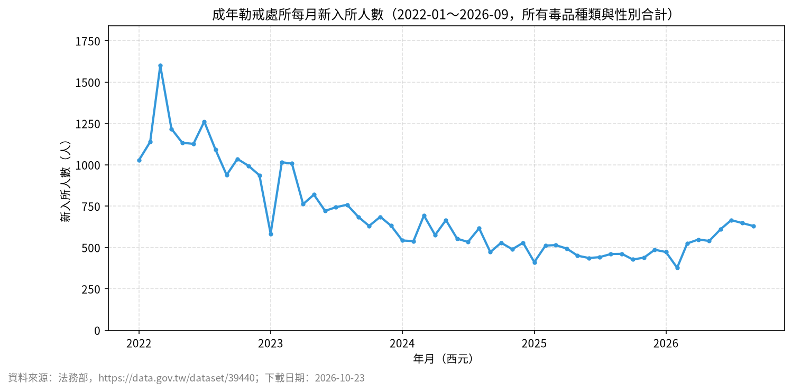

# 📊 14｜法務部公開統計：三階提問實作

[](https://colab.research.google.com/github/roberthsu2003/ai-excel-analytics/blob/main/AI%E5%8D%94%E4%BD%9C%E8%B3%87%E6%96%99%E5%88%86%E6%9E%90/14_moj_public_data/lesson.ipynb) 👉 **[開啟本例筆記本 lesson.ipynb](./lesson.ipynb)**

| [⬅️ 13 辦公室資料](../13_office_chart_basics/README.md) | [🏠 範例庫目錄](../README.md) | （最後一例） |
| :--- | :---: | ---: |

## 📌 本例速覽

| 項目 | 內容 |
| :--- | :--- |
| 資料情境 | `moj_data_A.csv、moj_data_B.csv、moj_data_C.csv（真實法務部公開資料）` |
| 一列代表 | **依選擇的開放資料集定義（例如一個年度的統計數據）** |
| 官方範例問題 | **依你所選的官方資料集，歷年數據呈現怎樣的變化趨勢？** |
| 官方推薦圖表 | **折線圖** |
| 學習模式 | **三階提問法**：① 看懂資料 ➔ ② 一題一圖（人機選圖） ➔ ③ 解讀洞察與限制 ➔ ④ RTCCF 交付 |

### 🎯 官方範例主線成果圖


> [!TIP]
> **你不需要會寫程式。** 在本範例中，你負責想問題、從 AI 建議中評估選圖、親自檢查邊界與核對數字；寫程式與繪圖完全交給 Colab 裡的 AI。

---

## 1️⃣ 資料背景與思考邊界

### ① 欄位角色貼標籤
| 欄位名稱 | 資料類型 | 欄位角色 (Data Role) | 說明與規則 |
| :--- | :--- | :--- | :--- |
| **日期（A）、民國年＋月份（B、C）** | 文字／整數 | 🔵 **條件 (Dimension)／時間** | 民國年要＋1911 轉西元；月份是「01」這種文字。 |
| **毒品種類、觀勒次數、性別（B）** | 文字 | 🔵 **條件 (Dimension)／類別** | 分組用；觀勒次數是「初次／再次」，不是數值。 |
| **被害補償金類別（C）** | 文字 | 🔵 **條件 (Dimension)／類別** | 遺屬、重傷、性侵害補償金。 |
| **人（B）** | 整數（人） | 🟢 **指標 (Metric)** | 新入所**人數**；沒有母體人口，不能算盛行率。 |
| **新臺幣元（C）** | 整數（元） | 🟢 **指標 (Metric)** | 決定補償**金額**，不是件數。 |
| **實際收容、核定容額、入監／出監人數（A）** | 整數（人） | 🟢 **指標 (Metric)** | 單日數字；超收率是文字（例如「5.7%」）。 |

### ② 邊界檢核防呆（分析紅線）
- ⚠️ **先寫來源卡**：發布機關、資料頁網址、下載日期、資料期間、單位、一列代表什麼；來源不清楚就先停。
- ⚠️ **民國年要轉換、期間要完整**：民國 115 年＝西元 2026 年；最新年度若不滿 12 個月，不能和完整年度比較全年總量。
- ⚠️ **單日快照不能畫趨勢**：A 每次下載只有一天的資料，要看趨勢必須每天自行保存，不能用一筆資料說「越來越多」。
- ⚠️ **人數、件數、金額不能互換**：補償金額高不代表案件多；新入所人數不等於盛行率（沒有人口分母）。
- ⚠️ **彙整統計不推個人、不推政策因果**：不能回推任何個人，也不能把同期變化直接寫成某項政策的成效。
- ⚠️ **下載也可能失敗**：A 的官方網站憑證設定不完整，Python 自動下載會被拒絕；請改用瀏覽器下載後上傳，並在來源卡記下下載日期。
- ⚠️ **欄位會改版**：若實際欄位和教材不同，參考程式會停下來；請改用 Prompt 讓 AI 依實際欄位產生程式，**不得補造欄位或數字**。

---

## 2️⃣ 在 Colab 操作：三階提問 SOP

點擊上方 **Open in Colab** 徽章開啟 [`lesson.ipynb`](./lesson.ipynb) 後，依序進行人機協作：

### 第 0 步｜載入資料與繁中字型
點擊第 0 步儲存格左側的 ▶ 執行按鈕，系統會自動下載所需資料並配置繁體中文字型。

### ① 第一階｜看懂資料
將以下 Prompt 貼給 Colab 側邊的 Gemini AI：
```text
請讀取已載入/下載的資料（data/moj_data_B.csv）：
1. 顯示前 5 列、總列數、所有欄位名稱與各欄缺值數
2. 說明「一列代表什麼」，並將所有欄位分成「指標」、「條件」、「標識」三種角色
3. 檢查資料的時間範圍、重複值或異常/缺值狀況
4. 根據資料欄位，提出 5 個可以回答的商業/分析問題（涵蓋不同面向），以及 1 個不能回答的問題並說明理由
⚠️ 先不要寫程式畫圖，也不要提前下推論或結論。
```
**驗收標準**：確認資料筆數、缺值數量與欄位角色判斷是否正確。

---

### ② 第二階｜一個問題、一張圖（人機協作選圖）

#### 步驟 2-1｜填入問題，請 AI 建議圖表與優缺點
你可以從第一階產生的 5 個問題中挑選，或使用官方範例問題：
```text
延續第一階，我想針對這個問題進行深入分析：
『依你所選的官方資料集，歷年數據呈現怎樣的變化趨勢？』

請先不要寫程式畫圖，請先：
1. 說明這個問題屬於哪種問題類型（比較、趨勢、占比、分布、關聯）。
2. 建議 2～3 種適合呈現此問題的圖表類型，並條列分析每種圖表的「優點」與「缺點」（請考慮類別數量、名稱長短、數值特性等）。
3. 說明你最推薦哪一種圖表，以及推薦的理由是什麼。
等我確認要採用哪種圖表後，我們再進行下一步。
```

#### 步驟 2-2｜決定圖表，請 AI 產出數字表與繪圖
由你根據選圖規則決定圖表類型（例如：折線圖）：
```text
我決定採用【折線圖】。

請先產出排序好的統計數字表，再只畫一張【折線圖】。
繪圖注意事項：
1. 自動配置合適的坐標軸（若有數值軸請從 0 開始，避免截斷視覺比例）
2. 圖上清楚標註數值與單位，文字全部使用繁體中文（沿用已設定的字型）
3. 排除無效或缺值的資料，並符合邊界檢核防呆
⚠️ 一次只回答這個問題，不要畫其他無關圖表。
```
> 💡 **官方範例推薦理由：** 官方統計多為年度連續時間序列，折線圖最適合呈現歷年政策推動後的起伏走勢；確保年份由早到晚依序排列。

**驗收標準**：核對圖表上的數字與排序數字表一致，數值軸從 0 開始，單位標註清楚。

---

### ③ 第三階｜解讀數據與圖表（說出洞察與限制）
留在同一段 AI 對話，請 AI 完整解讀：
```text
請根據剛才產出的數字表與圖表，說明如何正確解釋這些分析結果。

解讀注意事項：
1. 核心結論：回答剛才設定的問題，並引用圖表中的具體數據支持
2. 數據洞察：說明數據與圖表呈現的重要現象、極端值或趨勢特徵
3. 資料限制：寫明統計範圍、分母，以及是否有被排除的資料（如缺考、異常值、未完成訂單）
4. 不能推論的事：說明單憑目前數據無法證明什麼（嚴守邊界：不把相關當因果、不妄下過度結論）
```
**驗收標準**：結論有具體數據支持，未把相關當因果，並指明資料限制。

---

### ④ 第四階｜交付報告（選做：產出 RTCCF 提示詞）
完成分析後，可使用第四階 Prompt，請 Colab AI 將前三階成果打包成符合 **RTCCF 框架** 的提示詞，直接交給外部 AI 生成可交付的 **Word 報告（.docx）** 或 **Excel 活頁簿（.xlsx）**！

---

| [⬅️ 13 辦公室資料](../13_office_chart_basics/README.md) | [🏠 範例庫目錄](../README.md) | （最後一例） |
