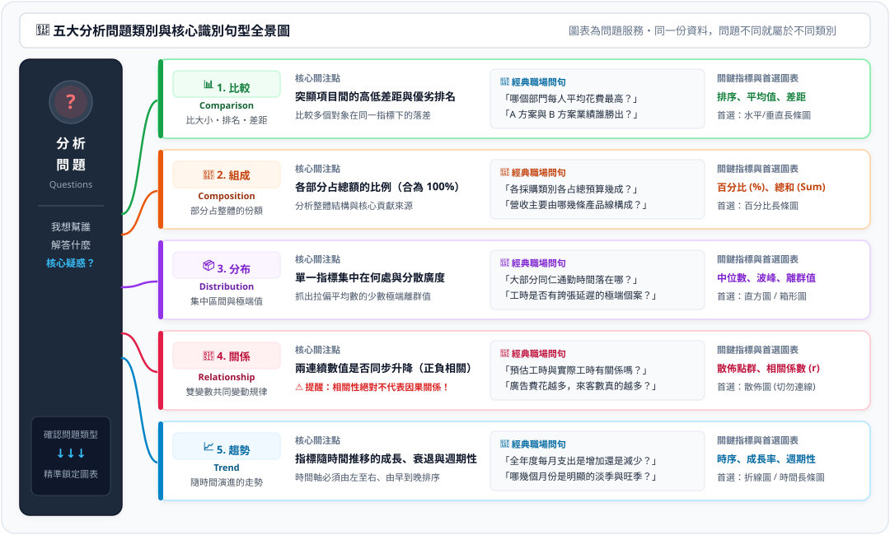
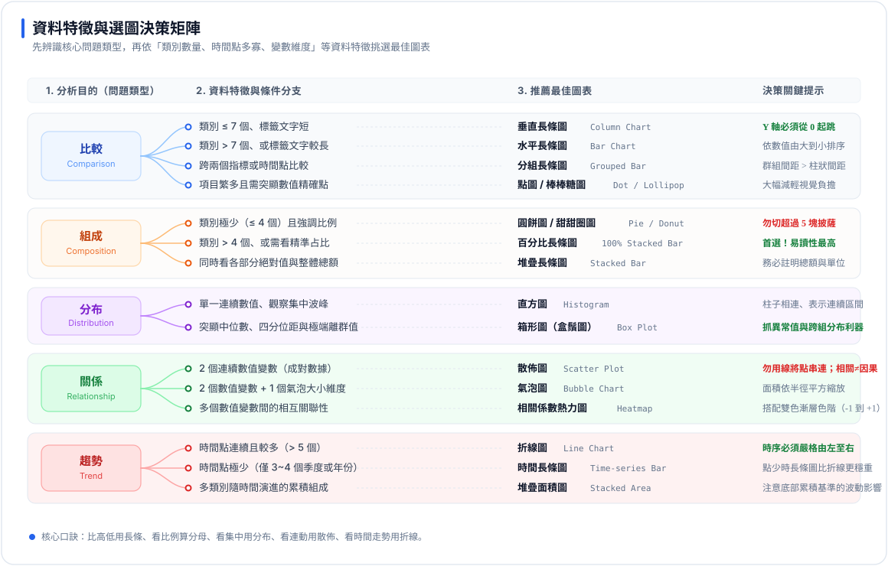
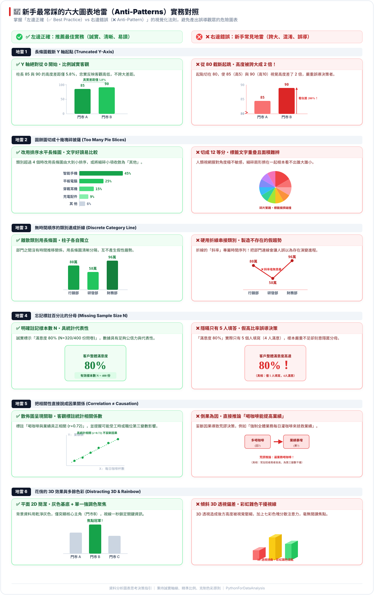

# 🤖 AI × Excel 資料分析：讓 AI 做表、讓 AI 分析

> [!IMPORTANT]
> **這份教材寫給「不會寫程式、但每天用 Excel」的你。**
> 你不用先背公式，也不用先學 Python。整份教材只練兩件事：
>
> 1. **說清楚需求，讓 AI（Claude、ChatGPT、Gemini）直接產生 `.xlsx` 試算表**——不再手動建表。
> 2. **看懂資料、問對問題，讓 AI 幫你分析與畫圖**——你負責想清楚與驗收，程式交給 AI。

---

## 🧭 學習路線總覽

| 部 | 主題 | 你會帶走的能力 | 從這裡開始 |
| :---: | :--- | :--- | :--- |
| **一** | **用 AI 生成 Excel 試算表** | 開出「規格書」讓 AI 一次產出：無合併儲存格、純數值、有公式、有防呆的活檔案 | 📗 [前導核心＋五大階梯](#第一部用-ai-生成-excel-試算表) |
| **二** | **看懂資料與選對圖表** | 拿到陌生表格，說出「能回答什麼、該用什麼圖、哪些結論不能下」 | 📊 [7 堂課＋動手做](#第二部看懂資料與選對圖表) |
| **三** | **AI 協作資料分析** | 在 Colab 指揮 AI 讀檔、清理、計算、畫圖，並親自驗收結果 | 🤖 [14 個循序範例](#第三部ai-協作資料分析14-個循序範例) |

> 💡 **為什麼先學「生成 Excel」？** 分析的品質取決於資料的品質。第一部學會的「一列一筆、不合併、純數值」，正是第二、三部 AI 能不能讀懂你資料的前提。

🌐 **互動網站**：[學習首頁](https://roberthsu2003.github.io/ai-excel-analytics/)｜[選圖互動實驗室](https://roberthsu2003.github.io/ai-excel-analytics/chart-selection/)｜[14 個範例卡片頁](https://roberthsu2003.github.io/ai-excel-analytics/ai-examples/)

---

## 第一部｜用 AI 生成 Excel 試算表

> **核心觀念**：不是叫 AI「幫我做一張銷售表」，而是像架構師一樣開出規格，讓 AI 產出能排序、能篩選、能樞紐分析的**活檔案**。

📘 **完整教材**：[Excel (.xlsx) 試算表生成模組：五階漸進實戰指南](https://github.com/roberthsu2003/workflow-productivity/blob/main/%E5%B8%B8%E8%A6%8B%E7%9A%84AI%E6%87%89%E7%94%A8/%E8%BE%A6%E5%85%AC%E5%AE%A4%E5%85%A8%E8%83%BD%E6%87%89%E7%94%A8/Excel%E8%A9%A6%E7%AE%97%E8%A1%A8%E7%9A%84%E7%94%9F%E6%88%90/README.md)（位於 workflow-productivity 專案）

### 人機協作四步閉環

| 步驟 | 你做什麼 | AI 做什麼 |
| :---: | :--- | :--- |
| ① | 用白話說出需求、上傳原始資料 | — |
| ② | — | 轉成 RTCCF 規格書（`.md`），鎖定分頁、欄位、公式、防呆 |
| ③ | 看「數據與邏輯審核卡片」，檢查公式、格式、數值 | 列出審核卡片供你預檢 |
| ④ | 回覆「審核通過」 | 正式產生並匯出 `.xlsx` 檔 |

### 前導心法＋五大階梯

| 階梯 | 主題 | 告別的痛苦 | 交付成果 |
| :---: | :--- | :--- | :--- |
| 🧠 | [前導核心：AI 時代的 Excel 資料架構與審核心法](https://github.com/roberthsu2003/workflow-productivity/blob/main/%E5%B8%B8%E8%A6%8B%E7%9A%84AI%E6%87%89%E7%94%A8/%E8%BE%A6%E5%85%AC%E5%AE%A4%E5%85%A8%E8%83%BD%E6%87%89%E7%94%A8/Excel%E8%A9%A6%E7%AE%97%E8%A1%A8%E7%9A%84%E7%94%9F%E6%88%90/00_%E5%89%8D%E5%B0%8E%E6%A0%B8%E5%BF%83_AI%E6%99%82%E4%BB%A3%E7%9A%84Excel%E8%B3%87%E6%96%99%E6%9E%B6%E6%A7%8B%E8%88%87%E5%AF%A9%E6%A0%B8%E5%BF%83%E6%B3%95/README.md) | 盲目下指令產出合併儲存格、死數字的廢表 | 規格書 Prompt 四維度範本 |
| 🟢 1 | [基礎建表與運算](https://github.com/roberthsu2003/workflow-productivity/blob/main/%E5%B8%B8%E8%A6%8B%E7%9A%84AI%E6%87%89%E7%94%A8/%E8%BE%A6%E5%85%AC%E5%AE%A4%E5%85%A8%E8%83%BD%E6%87%89%E7%94%A8/Excel%E8%A9%A6%E7%AE%97%E8%A1%A8%E7%9A%84%E7%94%9F%E6%88%90/01_%E9%9A%8E%E6%A2%AF%E4%B8%80_%E5%9F%BA%E7%A4%8E%E5%BB%BA%E8%A1%A8%E8%88%87%E9%81%8B%E7%AE%97_%E5%91%8A%E5%88%A5%E6%8E%92%E7%89%88%E5%9C%B0%E9%9B%B7%E8%88%87%E5%85%AC%E5%BC%8F%E8%AA%9E%E6%B3%95/README.md) | 合併儲存格無法篩選、金額打「元」無法加總 | 部門差旅與專案費用報銷表 |
| 🟡 2 | [資料防呆與自動警示](https://github.com/roberthsu2003/workflow-productivity/blob/main/%E5%B8%B8%E8%A6%8B%E7%9A%84AI%E6%87%89%E7%94%A8/%E8%BE%A6%E5%85%AC%E5%AE%A4%E5%85%A8%E8%83%BD%E6%87%89%E7%94%A8/Excel%E8%A9%A6%E7%AE%97%E8%A1%A8%E7%9A%84%E7%94%9F%E6%88%90/02_%E9%9A%8E%E6%A2%AF%E4%BA%8C_%E8%B3%87%E6%96%99%E9%98%B2%E5%91%86%E8%88%87%E8%87%AA%E5%8B%95%E8%AD%A6%E7%A4%BA_%E5%91%8A%E5%88%A5%E6%89%8B%E5%8B%95%E6%AA%A2%E6%9F%A5%E8%88%87%E7%9C%BC%E8%8A%B1%E6%8A%93%E6%BC%8F/README.md) | 狀態亂填、肉眼找超支 | 專案里程碑與預算進度管控表 |
| 🟠 3 | [髒資料清洗與轉化](https://github.com/roberthsu2003/workflow-productivity/blob/main/%E5%B8%B8%E8%A6%8B%E7%9A%84AI%E6%87%89%E7%94%A8/%E8%BE%A6%E5%85%AC%E5%AE%A4%E5%85%A8%E8%83%BD%E6%87%89%E7%94%A8/Excel%E8%A9%A6%E7%AE%97%E8%A1%A8%E7%9A%84%E7%94%9F%E6%88%90/03_%E9%9A%8E%E6%A2%AF%E4%B8%89_%E9%AB%92%E8%B3%87%E6%96%99%E6%B8%85%E6%B4%97%E8%88%87%E8%BD%89%E5%8C%96_%E5%91%8A%E5%88%A5%E7%84%A1%E6%AD%A2%E5%A2%83%E8%A4%87%E8%A3%BD%E8%B2%BC%E4%B8%8A/README.md) | LINE 留言手動貼、民國年混雜、數字夾單位 | 各部門採購需求規範審核表 |
| 🔵 4 | [跨表關聯與多維統計](https://github.com/roberthsu2003/workflow-productivity/blob/main/%E5%B8%B8%E8%A6%8B%E7%9A%84AI%E6%87%89%E7%94%A8/%E8%BE%A6%E5%85%AC%E5%AE%A4%E5%85%A8%E8%83%BD%E6%87%89%E7%94%A8/Excel%E8%A9%A6%E7%AE%97%E8%A1%A8%E7%9A%84%E7%94%9F%E6%88%90/04_%E9%9A%8E%E6%A2%AF%E5%9B%9B_%E8%B7%A8%E8%A1%A8%E9%97%9C%E8%81%AF%E8%88%87%E5%A4%9A%E7%B6%AD%E7%B5%B1%E8%A8%88_%E5%91%8A%E5%88%A5VLOOKUP%E7%A0%B4%E5%9C%96%E8%88%87%E5%85%AC%E5%BC%8F%E6%81%90%E6%87%BC/README.md) | VLOOKUP 破圖、`#N/A`、多條件統計記不住 | 多通路銷售毛利與跨表統計分析表 |
| 🟣 5 | [商業儀表板與視覺化](https://github.com/roberthsu2003/workflow-productivity/blob/main/%E5%B8%B8%E8%A6%8B%E7%9A%84AI%E6%87%89%E7%94%A8/%E8%BE%A6%E5%85%AC%E5%AE%A4%E5%85%A8%E8%83%BD%E6%87%89%E7%94%A8/Excel%E8%A9%A6%E7%AE%97%E8%A1%A8%E7%9A%84%E7%94%9F%E6%88%90/05_%E9%9A%8E%E6%A2%AF%E4%BA%94_%E5%95%86%E6%A5%AD%E5%84%80%E8%A1%A8%E6%9D%BF%E8%88%87%E8%A6%96%E8%A6%BA%E5%8C%96_%E7%9B%B4%E4%B8%8A%E4%B8%BB%E7%AE%A1%E7%B4%9A%E5%95%86%E5%8B%99%E7%9C%8B%E6%9D%BF/README.md) | 圖表配色刺眼、說不出商業洞察 | 全通路營運績效與銷售分析儀表板 |

### 防坑四大鐵律（也是後面分析的前提）

1. **資料列不合併儲存格**：一列就是一筆紀錄，才能排序、篩選、樞紐分析。
2. **純數值**：金額不打 `元`、`NT$`，單位交給儲存格格式 `#,##0`。
3. **跨表查詢用 XLOOKUP**：不受欄號限制，增刪欄位不破圖。
4. **公式優先**：小計、總計、毛利率一律用公式，不填算好的死值。

---

## 第二部｜看懂資料與選對圖表

> **核心觀念**：拿到表格**不要先想畫什麼圖**，先照固定順序想清楚——想清楚了，畫圖就可以交給 AI。

整部只有一條思考順序，**請背下來**：

> **① 欄位貼標籤 ➔ ② 套提問積木 ➔ ③ 邊界檢核 ➔ ④ 判斷問題類別 ➔ ⑤⑥ 選對圖表 ➔ ⑦ 交給 AI 並驗收**

📇 **一頁速查卡**（上課、做範例時放在旁邊，可列印）：[資料分析速查卡](./圖解/資料分析速查卡.svg)

### 🗺️ 學習地圖：7 堂課＋動手做

由淺至深，**一次一課，照順序通關**。讀完能說出「帶走的重點」就可以往下。

#### 🟢 階段一：看懂資料與學會提問（第 1～3 課）
* **1️⃣ 欄位貼標籤** ｜ 每一欄先分指標、條件、標識；編號不能拿來算  
  👉 📖 [數據欄位與提問思考規則・步驟 1](./數據欄位與提問思考規則/README.md#步驟-1欄位角色貼標籤認識數據積木)
* **2️⃣ 套提問積木** ｜ 挑 1～3 個欄位，套句型就能問出好問題  
  👉 📖 [數據欄位與提問思考規則・步驟 2](./數據欄位與提問思考規則/README.md#步驟-2套用提問公式積木組合問句)
* **3️⃣ 邊界反向檢核** ｜ 畫出紅線，先找出這份資料「不能回答」的問題  
  👉 📖 [數據欄位與提問思考規則・步驟 3](./數據欄位與提問思考規則/README.md#步驟-3邊界反向檢核防呆畫出不能問的紅線)

#### 🔵 階段二：精準選圖與避開地雷（第 4～6 課）
* **4️⃣ 五大問題類別** ｜ 所有問題都屬於：比較、組成、分布、關係、趨勢  
  👉 📖 [五大問題類別與識別句型](./五大問題類別與識別句型/README.md)
* **5️⃣ 認識圖表與坐標軸** ｜ X 軸放條件、Y 軸放指標；長條圖數值軸必須從 0 開始  
  👉 📖 [常用圖表名稱與坐標軸說明](./常用圖表名稱與坐標軸說明/README.md)
* **6️⃣ 依條件選圖與避雷** ｜ 同類問題依項目多寡與長短換圖，避開 6 大圖表地雷  
  👉 📖 [決定適合圖表的思考規則](./決定適合圖表的思考規則/README.md)（附 15 個圖表 Colab 範例）

#### 🟡 階段三：指揮 AI 產出（第 7 課）
* **7️⃣ 和 AI 協作：三階提問法** ｜ 先讓 AI 看懂資料，再一次一張圖，最後說出限制  
  👉 📖 [和 AI 協作的三階提問法](./和AI協作的三階提問法/README.md)

#### 🔴 階段四：動手實作與挑戰
* **✋ 動手做：五張圖由淺至深** ｜ 用同一份辦公室資料，把 7 堂課完整走一遍  
  👉 💻 [README.ipynb](./README.ipynb)（[在 Colab 開啟](https://colab.research.google.com/github/roberthsu2003/ai-excel-analytics/blob/main/README.ipynb)）
* **🚀 挑戰：陌生的真實資料** ｜ 拿到沒看過的空氣品質資料，自己走完整套流程  
  👉 💻 [範例_陌生資料挑戰_空氣品質.ipynb](./學生素材/範例_陌生資料挑戰_空氣品質.ipynb)（[在 Colab 開啟](https://colab.research.google.com/github/roberthsu2003/ai-excel-analytics/blob/main/%E5%AD%B8%E7%94%9F%E7%B4%A0%E6%9D%90/%E7%AF%84%E4%BE%8B_%E9%99%8C%E7%94%9F%E8%B3%87%E6%96%99%E6%8C%91%E6%88%B0_%E7%A9%BA%E6%B0%A3%E5%93%81%E8%B3%AA.ipynb)）

<b>📝 展開：每堂課的一頁重點摘要</b>

#### 第 1 課｜欄位貼標籤：先認識每一欄

| 標籤 | 怎麼認 | 例子 | 可以做什麼 |
| :--- | :--- | :--- | :--- |
| 🟢 **指標** | 有單位的數字 | 金額（元）、工時（小時）、人數 | 加總、平均、比大小 |
| 🔵 **條件** | 文字類別或日期 | 部門、產品類別、月份 | 分組、排序 |
| ⚪ **標識** | 每列都不一樣的編號 | 員工編號、訂單編號 | **只能數有幾筆**，不能加總或平均 |

> ⚠️ 員工編號「10023」長得像數字，但它是**標識**，算它的平均沒有任何意義。

#### 第 2 課｜套提問積木：挑欄位，套句型

| 挑的欄位 | 可以問 | 例子 |
| :--- | :--- | :--- |
| 1 個指標 | 大多集中在多少？有沒有極端值？ | 同仁通勤時間大多幾分鐘？ |
| 1 個類別 ＋ 1 個指標 | 誰最高？各占多少？ | 哪個部門支出最多？ |
| 1 個時間 ＋ 1 個指標 | 怎麼變化？哪個月最高？ | 每月支出是增加還是減少？ |
| 2 個指標 | 一個變大，另一個也變大嗎？ | 預估工時越長，實際工時也越長嗎？ |
| 類別 ＋ 時間 ＋ 指標 | 各組的走勢一樣嗎？ | 各部門每月支出走勢一致嗎？ |

#### 第 3 課｜邊界檢核：先畫出「不能問」的紅線

| 資料的樣子 | 不能問 | 為什麼 |
| :--- | :--- | :--- |
| 沒有時間欄位 | 「業績有沒有進步？」 | 沒有過去可以比 |
| 沒有類別欄位 | 「業務部是不是比客服部好？」 | 沒辦法分組 |
| 兩個指標有關聯 | 「多喝咖啡會讓業績變好嗎？」 | **相關不等於因果** |
| 只有百分比 | 「滿意度 80%，所以大家都很滿意」 | 不知道**分母**是 5 人還是 500 人 |

#### 第 4 課｜五大問題類別：你問的是哪一種？

| 類別 | 聽到這種句子 | 首選圖表 |
| :--- | :--- | :--- |
| **比較** | 「誰最高？」「排名？」 | 長條圖 |
| **組成** | 「各占多少？」「比例？」 | 百分比長條圖 |
| **分布** | 「大多落在哪？」「有沒有極端值？」 | 直方圖、箱形圖 |
| **關係** | 「A 變大，B 也變大嗎？」 | 散佈圖 |
| **趨勢** | 「怎麼變化？」「哪個月最高？」 | 折線圖 |

#### 第 5 課｜認識圖表與坐標軸

- **X 軸（橫軸）放條件**：部門、類別、月份。
- **Y 軸（縱軸）放指標**：金額、人數、工時。
- **長條圖的數值軸一定從 0 開始**；項目多或名稱長時，改用**水平長條圖**（軸對調）。
- 跟 AI 溝通時，說出圖表的中英文名稱（例如「水平長條圖 Horizontal Bar Chart」）最不容易誤會。

#### 第 6 課｜依條件選圖、避開六大地雷

| 問題類別 | 資料條件 | 選這個 |
| :--- | :--- | :--- |
| 比較 | 項目 ≤ 6 個、名稱短 | 垂直長條圖 |
| 比較 | 項目多或名稱長 | 水平長條圖（排序） |
| 組成 | 類別 ≤ 4 個 | 甜甜圈圖也可以 |
| 組成 | 類別 > 4 個 | 百分比長條圖 |
| 趨勢 | 時間點多 | 折線圖 |
| 趨勢 | 只有 3～4 個時間點 | 長條圖 |
| 關係 | 3 個以上的數值欄位 | 相關係數熱力圖 |

#### 第 7 課｜和 AI 協作：三階提問法

本課有[**三個獨立的 xlsx＋Colab 範例**](./和AI協作的三階提問法/README.md)：社區服務案件（比較）、單車租借月報（趨勢）、閱讀時間與測驗（關係）。

| 階段 | 你對 AI 說 | 你要檢查 |
| :--- | :--- | :--- |
| **第一階：看懂資料** | 「讀取資料，告訴我一列代表什麼、每欄是什麼角色，**先不要畫圖**。」 | 筆數、欄位、缺值對嗎？ |
| **第二階：一次一張圖** | 「回答【一個問題】，畫【圖表名稱】，X 軸放…、Y 軸放…，從 0 開始，標上單位。」 | 圖上的數字和表格一樣嗎？ |
| **第三階：說出限制** | 「用三句話說：結論、資料限制、不能推論的事。」 | 有沒有把相關說成因果？ |

### ✋ 動手做：用辦公室資料畫五張圖

打開 [README.ipynb](./README.ipynb)，用 [五類圖表_練習資料.xlsx](./學生素材/五類圖表_練習資料.xlsx) 依序完成五張圖，每一張只多一個新觀念：

| 順序 | 問題 | 類別 | 圖表 | 這張圖多學的一件事 |
| :---: | :--- | :--- | :--- | :--- |
| 1 | 哪個部門每人平均支出最高？ | 比較 | 垂直長條圖 | 數值軸從 0 開始、標上單位 |
| 2 | 每月支出怎麼變化？ | 趨勢 | 折線圖 | 時間由早到晚排序才能連線 |
| 3 | 各採購類別各占多少？ | 組成 | 百分比長條圖 | 先講清楚**分母** |
| 4 | 同仁通勤時間大多多久？ | 分布 | 直方圖 | 平均數和中位數要一起看 |
| 5 | 預估工時和實際工時有關嗎？ | 關係 | 散佈圖 | **相關不等於因果** |

資料說明請看[學生素材資料卡](./學生素材/DATA_CARD.md)；本部所有素材可一次下載：[看懂資料與選對圖表_學生素材.zip](./看懂資料與選對圖表_學生素材.zip)。第 7 課的三份 xlsx 請從[三階提問法教材](./和AI協作的三階提問法/README.md)下載。

---

## 第三部｜AI 協作資料分析：14 個循序範例

> **核心觀念**：你負責想問題、檢查答案；寫程式交給 Colab 裡的 AI。每一例**只多學一件新事情**。

📂 **完整說明**：[AI 協作資料分析｜14 個循序實作範例](./AI協作資料分析/README.md)　🧯 卡住了？看[常見問題排解](./AI協作資料分析/常見問題排解.md)

| 階段 | 範例 | 這一段學會的事 |
| :--- | :--- | :--- |
| 🟢 熟悉流程 | [01 班級段考成績](./AI協作資料分析/01_class_scores/README.md)・[02 便利商店銷售](./AI協作資料分析/02_store_sales/README.md) | 走一次完整五步驟；缺考不是 0 分；營收要自己算 |
| 🔵 把亂資料整理乾淨 | [03 圖書館借閱](./AI協作資料分析/03_library_files/README.md)・[04 社區活動問卷](./AI協作資料分析/04_survey_cleaning/README.md)・[05 連鎖書店季報](./AI協作資料分析/05_bookstore_merge/README.md)・[06 縣市用電](./AI協作資料分析/06_power_reshape/README.md) | 讀對檔案、清理問卷、多表合併、長寬表轉換 |
| 🟡 數對東西、算對指標 | [07 健身房會員](./AI協作資料分析/07_gym_groupby/README.md)・[08 外送訂單](./AI協作資料分析/08_delivery_time/README.md)・[09 六城市氣象](./AI協作資料分析/09_weather_charts/README.md)・[10 台北租屋](./AI協作資料分析/10_rent_seaborn/README.md)・[11 業務週報](./AI協作資料分析/11_sales_kpi_style/README.md) | 人次≠人數、時區換算、依問題換圖、異常值、分子分母 |
| 🔴 自己來 | [12 共享單車（總整專題）](./AI協作資料分析/12_bike_capstone/README.md)・[13 辦公室資料](./AI協作資料分析/13_office_chart_basics/README.md)・[14 法務部公開統計](./AI協作資料分析/14_moj_public_data/README.md) | 綜合運用、五類問題各做一張、處理真實開放資料 |

---

## 📎 延伸資源

- 🧩 [Pandas、NumPy、Matplotlib 最適合搭配的介面工具比較表](./最適合搭配的介面工具比較表.md)：學完分析後，想把成果做成網頁或 App 時參考。
- 🐍 想看懂 AI 寫的程式？各範例的「對應程式碼篇」連到 [PythonForDataAnalysis](https://github.com/roberthsu2003/PythonForDataAnalysis) 的 pandas 教材。
