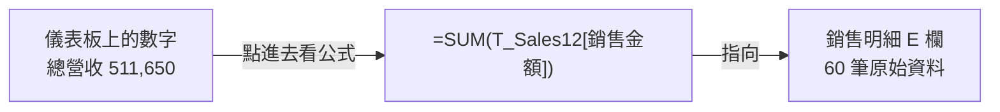

# 🟣 12｜主管儀表板總整：全通路營運儀表板

| [⬅️ 11 圖表](../11_圖表/README.md) | [🏠 第一部目錄](../README.md) | [➡️ 第二部：看懂資料與選對圖表](../../README.md#第二部看懂資料與選對圖表) |
| :--- | :---: | ---: |

## 📌 本課速覽

| 項目 | 內容 |
| :--- | :--- |
| 新觀念 | **總整**：把前面 11 課的觀念組成一份主管看的儀表板 |
| 新名詞 | 儀表板（Dashboard）、KPI（關鍵績效指標）、KPI 卡片、毛利、毛利率、可追溯 |
| 情境 | 2026 第一季三通路 60 筆訂單 |
| 📄 規範書 | [規範書_全通路營運儀表板.md](./規範書_全通路營運儀表板.md) |
| 📗 觀察檔案 | [全通路營運儀表板.xlsx](./全通路營運儀表板.xlsx) |

---

## 1️⃣ 白話需求

> 「季會要給總經理一頁就看懂的報表：本季賣多少、賺多少、毛利率、幾筆訂單，每月和各通路的圖，再幫我寫三個重點。總經理一定會問『這個數字怎麼來的』。」

最後一句是本課重點：**每個數字都要能追溯到明細**。

## 2️⃣ 這一課用到前面哪些觀念？

| 課 | 觀念 | 在本課哪裡 |
| :-: | :--- | :--- |
| 01 | 資料型態 | 日期是真日期，金額是數值 |
| 02 | 參照 | 計算表的 `$A2` 混合參照 |
| 03 | 函數 | SUM、COUNTA |
| 04 | 結構化表格 | `T_Sales12` |
| 05 | 邏輯判斷 | 毛利率的 `IF(…=0,0,…)` 防呆 |
| 09 | 條件統計 | 每月、每通路的 SUMIFS |
| 11 | 圖表 | 3 個時間點用直條圖、通路比較用橫條圖 |
| — | **三層分工** | 銷售明細（資料層）→ 計算 → 儀表板（展示層） |

## 3️⃣ 一份合格儀表板的三個檢查

1. **可追溯**：點任何 KPI，都看得到公式指向明細。
2. **不手打**：儀表板上沒有任何一個手打的數字。
3. **有限制**：重點文字除了好消息，也寫出資料的限制（呼應第二部「邊界檢核」）。

## 4️⃣ 本課觀念在規範書哪裡

| 規範書位置 | 寫了什麼 |
| :--- | :--- |
| **Context 工作表清單** | 儀表板、計算、銷售明細三張表，依順序排列 |
| **C1 第 1 條** | 只有儀表板允許合併儲存格 |
| **C1 第 6、7 條** | 不可手打數字；重點文字要與數字一致並寫限制 |
| **C2 儀表板位置表** | 每張卡片、圖表、文字放在哪裡 |
| **C6** | 圖表規格與配色（不用 3D、彩虹色） |
| **C7** | 預期 KPI 與重點文字 |

## 5️⃣ 打開 xlsx 觀察

- [ ] 「儀表板」是第一張工作表，打開就看到。
- [ ] 4 張 KPI 卡片：總營收 **511,650**、總毛利 **201,350**、毛利率 **39.4%**、訂單筆數 **60**。
- [ ] 點 **A4**（總營收）：`=SUM(T_Sales12[銷售金額])`，可以一路追到「銷售明細」。
- [ ] 看左邊直條圖：只有 3 個月，用直條圖；Y 軸從 0 開始。
- [ ] 看右邊橫條圖：電商平台營收最高。
- [ ] 讀 **A23～A27** 的重點文字，回到「計算」工作表核對：2 月營收 175,560 最高？門市毛利率 40.8% 最高？
- [ ] 切到「銷售明細」：沒有合併儲存格、沒有總計列，第 1 列就是欄位名稱。

> 🎓 **恭喜完成第一部！** 你已經能看懂規範書、審核 AI 的設計、驗收 AI 的成果。接下來的[第二部](../../README.md#第二部看懂資料與選對圖表)，會教你拿到一份資料時，該問什麼問題、選什麼圖。

## 6️⃣ AI 常見出錯點

| AI 可能寫錯 | 你在規範書看到的樣子 | 請 AI 改成 |
| :--- | :--- | :--- |
| KPI 填死值 | C3 沒有 KPI 公式 | 「KPI 全部用公式連到明細」 |
| 明細也合併美化 | C1 沒限定合併的範圍 | 「只有儀表板可以合併」 |
| 重點文字和數字對不上 | C7 沒寫預期重點 | 「列出重點文字依據的數字與位置」 |
| 只報喜不報憂 | 重點只有亮點 | 「加上至少 1 點資料限制」 |
| 3 個時間點用折線 | C6 圖 1 寫折線圖 | 「時間點少時用直條圖」 |
| 花俏配色 | 「漸層、3D、多彩」 | 「主色深藍，不用 3D」 |
