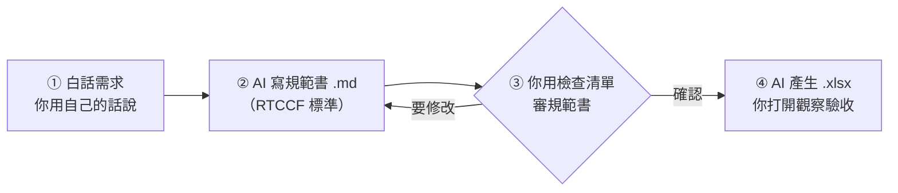

# 🟩 第一部｜用 AI 生成 Excel 試算表

> [!IMPORTANT]
> **這一部你完全不用動手做表。** 表格全部由 AI 產生，你只要做三件事：
> 1. **懂名詞**：知道欄、列、公式、資料型態是什麼。
> 2. **審規範書**：AI 動手前會先交一份「試算表規範書」，你看懂、確認。
> 3. **觀察驗收**：打開 AI 做好的 `.xlsx`，對照規範書檢查。

🌐 **互動網站**：[第一部互動專區](https://roberthsu2003.github.io/ai-excel-analytics/excel-generation/)（名詞圖鑑、公式參照動畫、規範書流程動畫）

---

## 🧭 人機協作四步流程



| 步驟 | 你做什麼 | AI 做什麼 | 用到的檔案 |
| :-: | :--- | :--- | :--- |
| ① | 用白話描述需求 | — | [通用提示詞.md](./通用提示詞.md) |
| ② | — | 依 RTCCF 標準寫出規範書，**先不做 Excel** | [規範書範本.md](./00_RTCCF規範書標準/規範書範本.md) |
| ③ | 逐項打勾，沒問題回覆「確認」 | 依你的意見修改 | [規範書檢查清單.md](./00_RTCCF規範書標準/規範書檢查清單.md) |
| ④ | 打開 `.xlsx`，對照規範書觀察 | 依規範書產生 `.xlsx` | 各課的觀察任務 |

> 💡 **不限定 AI**：任何能產生檔案的 AI 助理都可以。如果你的 AI 不能直接給檔案，就請它提供產生 `.xlsx` 的 Python 程式。

---

## 🗺️ 課程地圖：由淺至深

每一課**只多學一個 Excel 觀念**，並附上 AI 寫好的規範書和 xlsx 讓你打開觀察。

### 🧠 先備：看懂規範書的基礎

| 課 | 主題 | 你會帶走的能力 |
| :-: | :--- | :--- |
| 00 | 📘 [Excel 基本觀念](./00_Excel基本觀念/README.md) | 認得活頁簿、欄、列、儲存格、資料編輯列、資料型態、公式、錯誤代碼 |
| 00 | 📐 [RTCCF 規範書標準](./00_RTCCF規範書標準/README.md) | 知道規範書每一節在寫什麼、要看什麼 |

### 🟢 階段一：基礎建表

| 課 | 主題 | 情境 | 新觀念 |
| :-: | :--- | :--- | :--- |
| 01 | [儲存格與資料型態](./01_儲存格與資料型態/README.md) | 社團收支紀錄 | 值 vs. 顯示格式；文字、數值、日期 |
| 02 | [公式與參照](./02_公式與參照/README.md) | 商品報價單 | 公式；相對參照 vs. `$` 絕對參照 |
| 03 | [常用函數](./03_常用函數/README.md) | 班級成績表 | SUM、AVERAGE、ROUND、MAX、MIN、COUNT；空白 ≠ 0 |
| 04 | [一列一筆與結構化表格](./04_一列一筆與結構化表格/README.md) | 部門費用報銷表 | 四不二要；Excel Table 自動延伸 |

### 🟡 階段二：判斷、防呆與警示

| 課 | 主題 | 情境 | 新觀念 |
| :-: | :--- | :--- | :--- |
| 05 | [邏輯判斷](./05_邏輯判斷/README.md) | 業績獎金判定 | IF、IFS、AND |
| 06 | [資料驗證](./06_資料驗證/README.md) | 請假申請表 | 下拉選單、數值範圍、日期限制 |
| 07 | [條件式格式](./07_條件式格式/README.md) | 專案進度管控 | 超支紅字、逾期黃底、資料橫條 |

### 🔵 階段三：跨表與整理

| 課 | 主題 | 情境 | 新觀念 |
| :-: | :--- | :--- | :--- |
| 08 | [主檔與跨表查詢](./08_主檔與跨表查詢/README.md) | 訂單＋產品主檔 | XLOOKUP、查無資料的處理、三層分工 |
| 09 | [條件統計彙總](./09_條件統計彙總/README.md) | 多通路銷售 | SUMIFS、COUNTIFS；樞紐分析的觀念 |
| 10 | [髒資料清洗](./10_髒資料清洗/README.md) | 採購需求原始文字 | 民國年轉日期、剝除單位、原始與清洗後對照 |

### 🟣 階段四：視覺化

| 課 | 主題 | 情境 | 新觀念 |
| :-: | :--- | :--- | :--- |
| 11 | [圖表](./11_圖表/README.md) | 月營收 | 長條圖、折線圖、圓餅圖 |
| 12 | [主管儀表板總整](./12_主管儀表板總整/README.md) | 全通路營運 | KPI 卡片＋圖表；資料層與展示層分頁 |

---

## 📂 每一課的檔案

```
01_儲存格與資料型態/
├── README.md                ← 本課觀念、白話需求、觀察任務
├── 規範書_社團收支紀錄.md     ← AI 依 RTCCF 標準寫的規範書
└── 社團收支紀錄.xlsx          ← AI 依規範書產生的檔案（打開觀察用）
```

## 🔑 貫穿全部的四條鐵律

1. **資料列不合併儲存格**：一列就是一筆，才能排序、篩選、樞紐分析。
2. **型態要對**：金額是數值（不打「元」），日期是日期（不存成文字），編號要保留 0 就存成文字。
3. **公式優先**：算出來的都用公式，不填死值。
4. **資料和報表分開**：明細放資料層，總計、圖表放展示層。

> 這四條也是[第二部](../README.md#第二部看懂資料與選對圖表)、[第三部](../AI協作資料分析/README.md)讓 AI 讀懂你資料的前提。

---

[⬅️ 回到課程總覽](../README.md)
